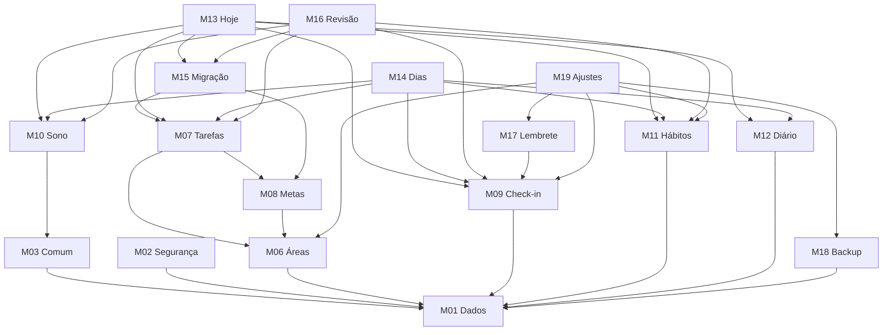

# Prumo — Detalhamento de Módulos da v1 (rev. 1.2)

> Complementa `prumo-especificacao-v1.2.md`. Aqui cada módulo da v1 tem responsabilidades, API de domínio, telas, regras de negócio, dependências, testes e critério de "pronto". O detalhamento das fases de codificação virá em seguida, usando este documento como base.

- **Data:** 16/11/2026
- **Plataforma:** Android (Kotlin + Jetpack Compose)

---

## 1. Organização do código

### 1.1 Estrutura

Um único módulo Gradle (`:app`), organizado **por funcionalidade** (*package-by-feature*). Dividir em vários módulos Gradle não compensa para um app pessoal feito por um desenvolvedor, e complica o trabalho com IA.

```
com.prumo.app
├── core
│   ├── database      (M01)
│   ├── security      (M02, chave do banco)
│   ├── common        (M03)
│   ├── designsystem  (M04)
│   └── navigation    (M05)
├── feature
│   ├── areas         (M06)
│   ├── tarefas       (M07)
│   ├── metas         (M08)
│   ├── checkin       (M09)
│   ├── sono          (M10)
│   ├── habitos       (M11)
│   ├── diario        (M12)
│   ├── hoje          (M13)
│   ├── dias          (M14)
│   ├── migracao      (M15)
│   ├── revisao       (M16)
│   ├── lembrete      (M17)
│   ├── backup        (M18)
│   └── ajustes       (M19)
└── di                (módulos Hilt)
```

Cada funcionalidade segue as mesmas camadas:

```
feature/<nome>
├── data      Entity (se for dona da tabela), DAO, RepositoryImpl
├── domain    modelos, interface Repository, casos de uso
└── ui        Screen (Compose), ViewModel, UiState, UiEvent, UiEffect
```

### 1.2 Regras de dependência

1. `ui` depende de `domain`. `domain` não depende de `ui` nem de Android.
2. `data` implementa as interfaces de `domain`.
3. **Uma funcionalidade nunca acessa o DAO ou a tabela de outra.** Conversa pelo repositório (interface) ou caso de uso da outra.
4. `hoje`, `dias` e `revisao` são **agregadores**: só leem, nunca escrevem em tabelas alheias.
5. Escritas que atravessam funcionalidades (ex.: migração cria meta e marca tarefa) acontecem em **uma transação**, orquestrada pelo módulo que dispara o fluxo.

### 1.3 Padrão de tela (UDF)

- `ViewModel` expõe `StateFlow<UiState>`; a UI envia `UiEvent`; efeitos de uma só vez (navegar, snackbar) saem por `Channel<UiEffect>`.
- Estados de tela sempre cobrem: **carregando, vazio, conteúdo, erro**.
- Datas e horas só por `Clock` injetado (nunca `LocalDate.now()` direto), para permitir teste.

### 1.4 Decisões de implementação (fecham lacunas do modelo)

| Tema | Decisão |
|---|---|
| minSdk | **26 (Android 8.0)**: canais de notificação nativos e Keystore estável (a biometria futura pedirá 30) |
| Horas | Guardar **minutos inteiros** (`horas_estimadas_min`, `horas_reais_min`); a UI mostra em horas. Evita erro de ponto flutuante |
| Frequência do hábito | Duas colunas: `tipo` (DIARIO / VEZES_NA_SEMANA) e `vezes_por_semana` (nulo se diário) |
| Hierarquia de metas | **Fora da v1** (sem meta-pai). A ligação é só tarefa → meta |
| Datas no banco | `LocalDate` como texto ISO (`2026-11-16`), `LocalTime` como texto `HH:mm`, instantes como epoch em ms |
| Sem internet | O manifesto **não declara** a permissão `INTERNET` |
| Backup do Android | `allowBackup="false"` e regras de extração vazias: o banco nunca vai para o backup automático do Google |
| Logs | Timber só em debug; em release, nenhum log de dados do usuário |
| Idioma | Interface em pt-BR, todas as strings em `strings.xml` |
| Bloqueio do app | **Fora da v1**: o banco é criptografado em repouso, mas o app abre sem autenticação (ver §8) |

---

## 2. Mapa de módulos

| ID | Módulo | Tipo | Fase | Requisitos |
|---|---|---|---|---|
| M01 | Núcleo de dados | Transversal | 0 | RNF02, RNF05, RNF09 |
| M02 | Segurança (chave do banco) | Transversal | 0 | RNF03, RNF03a |
| M03 | Núcleo comum (tempo e cálculos) | Transversal | 0 | RF08, RF12 (suporte) |
| M04 | Design system e UI base | Transversal | 0 | RNF01, RNF07 |
| M05 | Navegação e shell | Transversal | 0 | — |
| M06 | Áreas | Funcional | 1 | RF01, RF18 |
| M07 | Tarefas | Funcional | 1 | RF03, RF04, RF15, RF17 |
| M08 | Metas | Funcional | 4 | RF02 |
| M09 | Check-in e métricas | Funcional | 2 | RF06, RF07 |
| M10 | Sono | Funcional | 2 | RF08 |
| M11 | Hábitos | Funcional | 3 | RF09 |
| M12 | Diário | Funcional | 3 | RF10 |
| M13 | Hoje | Agregador | 1 a 3 | RF11 |
| M14 | Dias (histórico) | Agregador | 3 | RF16 |
| M15 | Migração de pendências | Funcional | 4 | RF05 |
| M16 | Revisão e análises | Agregador | 5 | RF12 |
| M17 | Lembrete diário | Funcional | 6 | RF14 |
| M18 | Backup | Funcional | 6 | RF13, RNF08 |
| M19 | Ajustes | Funcional | 1 a 6 | RF18 (UI), RNF03b |

### 2.1 Dependências entre módulos



Observação: `M07 → M08` existe só para vincular a tarefa a uma meta (consulta de metas ativas); o contrário (`M08 → M07`) é leitura de progresso via interface de domínio de tarefas.

---

## 3. Módulos transversais

### M01 — Núcleo de dados
- **Objetivo:** banco local criptografado, entidades, DAOs, conversores, migrações e dados iniciais.
- **Fase:** 0 (estrutura), ampliado a cada fase.
- **Responsabilidades:**
  - `PrumoDatabase` (Room, `exportSchema = true`) aberto com `SupportFactory` do SQLCipher usando a senha fornecida pelo M02.
  - Entidades: Area, Meta, Tarefa, Metrica, CheckInItem, Sono, Habito, HabitoRegistro, Diario, Configuracao.
  - Índices e restrições do §4.1 da especificação (UNIQUE em CheckInItem, HabitoRegistro, Diario, Sono e Meta).
  - Chaves estrangeiras: `Tarefa.area_id` RESTRICT; `Tarefa.meta_id` e `Tarefa.tarefa_origem_id` SET NULL; `Meta.area_id` RESTRICT; `CheckInItem.metrica_id` RESTRICT; `HabitoRegistro.habito_id` RESTRICT.
  - `TypeConverters` (datas, horas, enums).
  - Pasta `migrations/` com um teste por migração.
  - **Seed** na primeira criação: áreas padrão (Faculdade, Trabalho, Cybersec, Treino, Família/Relacionamento, Empreendimento), métricas padrão (energia, humor, foco, treino, alimentação), configurações padrão.
  - Provedor de banco **em memória** para testes.
- **API pública:** os DAOs ficam **internos**; cada funcionalidade expõe só o próprio repositório. O M01 expõe `TransactionRunner` (`suspend fun <T> inTransaction(block): T`) para escritas que atravessam funcionalidades.
- **Depende de:** M02 (senha do banco), M03 (conversores).
- **Testes:** criação do schema; cada restrição UNIQUE rejeita duplicata; cada FK se comporta como definido; teste de migração (com SQLCipher) para toda versão de schema nova.
- **Pronto quando:** o app abre o banco criptografado, o seed roda uma vez e os testes de schema e restrições passam.

### M02 — Segurança (chave do banco)
- **Objetivo:** manter o banco criptografado em repouso sem pedir nada ao usuário.
- **Fase:** 0.
- **Responsabilidades:**
  - `KeystoreKeyManager`: gera uma chave AES-GCM no Android Keystore com `setUserAuthenticationRequired(false)`.
  - No primeiro uso, gera uma **senha aleatória de 32 bytes**, cifra com a chave do Keystore e grava o resultado (IV + bytes cifrados) em armazenamento privado do app.
  - `PassphraseProvider`: decifra a senha e a entrega ao M01 na abertura do banco. A senha vive só em memória.
- **API de domínio:**
  ```kotlin
  interface PassphraseProvider { suspend fun get(): ByteArray }
  ```
- **Regras:**
  - Nunca registrar a senha em log nem exibi-la.
  - Se o arquivo da senha existe mas a chave do Keystore não (ex.: dados do app copiados para outro aparelho), mostrar um erro claro ("banco ilegível neste aparelho: restaure um backup") **sem apagar nada**. Com `allowBackup="false"` esse caso é raro.
  - Se nada existe, é a primeira execução: gerar chave e senha.
- **Depende de:** nada (é consumido pelo M01).
- **Testes:** primeira execução gera e persiste; a segunda devolve a mesma senha; chave ausente com arquivo presente gera o erro específico; teste instrumentado com o Keystore real; abrir o arquivo do banco sem a senha deve falhar.
- **Pronto quando:** o banco abre criptografado e o arquivo em disco não é legível sem a senha.
- **Futuro:** bloqueio por biometria (ver §8).

### M03 — Núcleo comum (tempo e cálculos)
- **Objetivo:** concentrar as regras de data e os cálculos puros, testáveis sem Android.
- **Fase:** 0.
- **Responsabilidades:**
  - `Clock` injetável (`today()`, `now()`).
  - `PeriodCalculator`: dado um nível (SEMANA, MES, ANO) e uma data âncora, devolve início e fim. Semana ISO (segunda a domingo), mês e ano calendário.
  - `SleepCalculator`: tempo na cama, tempo dormindo e avisos (§4.2 da especificação).
  - `StatsMath`: média, desvio-padrão e variação percentual entre períodos, tolerando listas vazias.
  - `CircularTime`: desvio-padrão de horários que cruzam a meia-noite. Horários de deitar entre 00:00 e 11:59 são deslocados +24 h antes do cálculo, para que 23:30 e 00:30 contem como 60 min de distância.
  - Formatadores pt-BR (data, duração "7 h 30 min").
  - Tipos utilitários: `AppResult`, dispatchers injetáveis.
- **API de domínio:**
  ```kotlin
  data class Period(val start: LocalDate, val end: LocalDate)
  fun periodOf(level: GoalLevel, anchor: LocalDate): Period
  data class SleepDurations(val inBed: Duration, val asleep: Duration, val warnings: List<SleepWarning>)
  fun computeSleep(bed: LocalTime, wake: LocalTime, latencyMin: Int, awakeMin: Int): SleepDurations
  ```
- **Testes (obrigatórios, muitos):** virada de semana e de ano; semana que cruza meses; fevereiro bissexto; sono que cruza a meia-noite; sono com tempo dormindo negativo; mais de 16 h na cama; desvio-padrão com horários dos dois lados da meia-noite; listas vazias.
- **Pronto quando:** cobertura alta de testes unitários, sem dependência de Android.

### M04 — Design system e UI base
- **Objetivo:** tema e componentes reutilizados em todas as telas, garantindo velocidade (RNF01) e acessibilidade (RNF07).
- **Fase:** 0, ampliado conforme necessário.
- **Responsabilidades:**
  - Tema Material 3 claro/escuro (cor dinâmica opcional).
  - Componentes: `RatingSelector` (1–5, um toque por valor), `PriorityChip`, `AreaBadge`, `SectionCard`, `EmptyState`, `ConfirmDialog`, `DatePickerField`, `TimePickerField`, `DurationField` (horas e minutos), `NoteField` (campo opcional que expande).
  - Padrão de *bottom sheet* para edição rápida.
  - Regras de acessibilidade embutidas: alvo mínimo de 48 dp, `contentDescription`, respeito à escala de fonte, contraste.
- **Testes:** testes de UI do `RatingSelector` (seleciona, troca e limpa o valor) e de semântica para TalkBack.
- **Pronto quando:** o `RatingSelector` permite registrar uma métrica com **um toque**.

### M05 — Navegação e shell
- **Objetivo:** esqueleto do app.
- **Fase:** 0.
- **Responsabilidades:**
  - `MainActivity` única; `AppNavHost` com Navigation Compose; rotas tipadas.
  - *Bottom navigation* com 4 destinos: **Hoje, Planejar, Revisão, Ajustes**.
  - *Deep link* `prumo://checkin` (usado pela notificação do M17).
  - Pilha de volta: cada aba mantém seu estado; sair do app pelo botão voltar na aba "Hoje".
- **Rotas principais:** `hoje`, `planejar`, `meta/{id}`, `dia/{data}`, `revisao`, `habito/{id}`, `sono/{data}`, `ajustes` e subtelas de ajustes.
- **Testes:** navegação entre abas preserva estado; o deep link abre o check-in.
- **Pronto quando:** as 4 abas navegam com telas vazias e o tema aplicado.

---

## 4. Módulos funcionais

### M06 — Áreas
- **Objetivo:** categorias da vida usadas para classificar tarefas e metas.
- **Fase:** 1. **Requisitos:** RF01, RF18.
- **Responsabilidades:** criar, renomear, trocar cor, reordenar, arquivar e excluir (só sem histórico).
- **API de domínio:**
  ```kotlin
  interface AreaRepository {
    fun observeActive(): Flow<List<Area>>
    fun observeAll(): Flow<List<Area>>
    suspend fun create(name: String, color: Int): AppResult<Long>
    suspend fun update(area: Area): AppResult<Unit>
    suspend fun reorder(orderedIds: List<Long>)
    suspend fun archive(id: Long)
    suspend fun deleteIfNoHistory(id: Long): AppResult<Unit>  // erro AreaHasHistory
  }
  ```
- **UI:** lista reordenável em Ajustes → Áreas; editor (nome + cor).
- **Regras:** nome obrigatório, único entre as áreas ativas, até 40 caracteres. "Histórico" = existe tarefa ou meta ligada à área. Área arquivada some dos seletores, mas continua aparecendo no histórico e nos gráficos.
- **Testes:** exclusão bloqueada com histórico; exclusão permitida sem histórico; arquivar preserva tarefas; ordem persistente.
- **Pronto quando:** o seletor de área das tarefas lista só áreas ativas, na ordem escolhida.

### M07 — Tarefas
- **Objetivo:** o coração do planejamento diário.
- **Fase:** 1. **Requisitos:** RF03, RF04, RF15, RF17.
- **Responsabilidades:** criar, editar, concluir, reabrir, excluir, reagendar; listar por dia; ordenar; fornecer consultas para outros módulos.
- **API de domínio:**
  ```kotlin
  interface TaskRepository {
    fun observeByDate(date: LocalDate): Flow<List<Task>>
    fun observePendingBefore(date: LocalDate): Flow<List<Task>>   // usado por M15
    suspend fun create(draft: TaskDraft): AppResult<Long>
    suspend fun update(task: Task): AppResult<Unit>
    suspend fun complete(id: Long, actualMinutes: Int?): AppResult<Unit>
    suspend fun reopen(id: Long)
    suspend fun delete(id: Long)
    suspend fun reschedule(id: Long, newDate: LocalDate): AppResult<Long> // cria nova, marca original MIGRADA
    suspend fun discard(id: Long)
  }
  ```
- **UI:** lista na tela "Hoje" (checkbox, título, chip de área, chip de prioridade, horas) e `TaskEditorSheet` (título, área, prioridade, data, meta opcional, horas estimadas).
- **Regras:**
  - Título de 1 a 120 caracteres; área obrigatória (padrão: última usada).
  - Ordenação: prioridade (alta, média, baixa), depois `criada_em`.
  - Aviso (não bloqueio) se a soma das horas estimadas do dia passar de 16 h.
  - Concluir sem horas reais grava `null`. Horas reais abrem vazias se não houve estimativa; senão sugerem a estimativa.
  - `atualizada_em` é atualizado em toda alteração.
  - Reagendar cria a nova tarefa com `tarefa_origem_id` e marca a original como MIGRADA.
  - Excluir tarefa MIGRADA não apaga a nova; a nova perde o `tarefa_origem_id` (SET NULL).
- **Testes:** ordenação; reagendar cria linhagem; concluir com e sem horas; exclusão preserva a nova tarefa; consultas por data.
- **Pronto quando:** dá para planejar, concluir e editar tarefas do dia em poucos toques.

### M08 — Metas
- **Objetivo:** metas de ano, mês e semana ligadas a áreas.
- **Fase:** 4. **Requisitos:** RF02.
- **Responsabilidades:** criar, editar, mudar status, listar por nível e período, calcular progresso informativo.
- **API de domínio:**
  ```kotlin
  interface GoalRepository {
    fun observeByLevelAndPeriod(level: GoalLevel, anchor: LocalDate): Flow<List<GoalWithProgress>>
    fun observeActiveForPicker(date: LocalDate): Flow<List<Goal>>
    suspend fun create(level: GoalLevel, anchor: LocalDate, title: String, areaId: Long): AppResult<Long>
    suspend fun updateStatus(id: Long, status: GoalStatus)
    suspend fun update(goal: Goal): AppResult<Unit>
    suspend fun delete(id: Long)   // tarefas vinculadas ficam sem meta
  }
  ```
- **UI (aba "Planejar"):** abas Semana / Mês / Ano com navegação entre períodos; lista de metas com barra de progresso; `GoalEditorSheet`; tela de detalhe da meta (`meta/{id}`) com as tarefas vinculadas.
- **Regras:** o período vem do `PeriodCalculator` (o usuário escolhe só a data âncora). Progresso = tarefas feitas ÷ tarefas vinculadas não descartadas; se não há tarefa vinculada, mostra "sem tarefas" e não 0%. Duplicata (mesmo nível, período, título e área) é bloqueada.
- **Testes:** período calculado; progresso com e sem tarefas; duplicata; excluir meta limpa o vínculo das tarefas.
- **Pronto quando:** metas criadas aparecem no seletor da tarefa e o progresso reflete as tarefas.

### M09 — Check-in e métricas
- **Objetivo:** notas diárias de 1 a 5, com nota de texto opcional.
- **Fase:** 2. **Requisitos:** RF06, RF07.
- **Responsabilidades:** gerenciar as métricas (CRUD, reordenar, ativar/desativar, arquivar/excluir sem histórico) e registrar os valores do dia.
- **API de domínio:**
  ```kotlin
  interface CheckInRepository {
    fun observeDay(date: LocalDate): Flow<List<MetricEntry>>   // todas as métricas ativas + valor/nota do dia
    suspend fun setValue(date: LocalDate, metricId: Long, value: Int?)   // null limpa
    suspend fun setNote(date: LocalDate, metricId: Long, note: String?)
  }
  interface MetricRepository { /* CRUD, reorder, archive, deleteIfNoHistory */ }
  ```
- **UI:** card "Check-in" em Hoje e **Check-in rápido** (*bottom sheet*): uma linha por métrica com `RatingSelector` e ícone de nota; indicador "3 de 5".
- **Regras:** valor de 1 a 5 ou vazio; `UNIQUE(data, metrica_id)` ⇒ gravação é *upsert*; a nota é opcional e não bloqueia; nota vazia grava `null`. A nota só pode ser salva se a métrica tiver valor (não existe linha só com nota); limpar o valor apaga também a nota. Métrica desativada deixa de aparecer no dia, mas o histórico permanece. Métrica nova aparece nos dias seguintes (os dias passados ficam vazios para ela).
- **Testes:** upsert não duplica; limpar valor remove a linha; nota sem valor é rejeitada; métrica desativada some do dia mas continua na revisão.
- **Pronto quando:** registrar 5 métricas leva menos de 60 s (medição manual) e editar o check-in do dia funciona.

### M10 — Sono
- **Objetivo:** registro detalhado do sono.
- **Fase:** 2. **Requisitos:** RF08.
- **Responsabilidades:** salvar, editar e excluir o registro do dia; calcular tempo na cama e tempo dormindo; sugerir valores.
- **API de domínio:**
  ```kotlin
  interface SleepRepository {
    fun observe(date: LocalDate): Flow<SleepLog?>       // date = data_referencia (dia do despertar)
    fun observeRange(start: LocalDate, end: LocalDate): Flow<List<SleepLog>>
    suspend fun save(log: SleepLogDraft): AppResult<Unit>   // upsert
    suspend fun delete(date: LocalDate)
  }
  ```
- **UI:** tela "Sono" (`sono/{data}`): seletores de hora (deitar e acordar), minutos para dormir, número de despertares, minutos acordado na madrugada, qualidade 1–5 e nota. Mostra, em tempo real, tempo na cama e tempo dormindo. Card de resumo em "Hoje" ("7 h 10 min dormindo · qualidade 4") ou botão "Registrar sono".
- **Regras:** `data_referencia` padrão = hoje; cálculo por `SleepCalculator`; avisos com pedido de confirmação (tempo na cama > 16 h; tempo dormindo negativo); sugestão do horário de deitar = o último usado.
- **Testes:** virada da meia-noite; avisos; upsert por data; exclusão; resumo em Hoje com e sem registro.
- **Pronto quando:** registrar o sono leva menos de 30 s e os dois tempos batem com os testes do M03.

### M11 — Hábitos
- **Objetivo:** acompanhar hábitos diários ou semanais.
- **Fase:** 3. **Requisitos:** RF09.
- **Responsabilidades:** CRUD, reordenar, arquivar/excluir sem histórico, marcar e desmarcar, calcular sequência.
- **API de domínio:**
  ```kotlin
  interface HabitRepository {
    fun observeForDay(date: LocalDate): Flow<List<HabitDayState>>   // hábito + feito hoje + progresso da semana
    fun observeDetail(id: Long): Flow<HabitDetail>                  // histórico e sequência
    suspend fun toggle(habitId: Long, date: LocalDate)
    /* create, update, reorder, archive, deleteIfNoHistory */
  }
  ```
- **UI:** seção "Hábitos" em Hoje (toque único marca/desmarca; mostra "2/3 esta semana" nos semanais); tela de detalhe (`habito/{id}`) com calendário de cumprimento e sequência.
- **Regras:**
  - DIARIO: a sequência conta dias consecutivos marcados até hoje. Se hoje ainda não foi marcado, a sequência não zera até o fim do dia.
  - VEZES_NA_SEMANA (X por semana): a sequência conta semanas ISO consecutivas em que o X foi atingido; a semana atual conta só quando atinge o X.
  - `UNIQUE(habito_id, data)` ⇒ marcar duas vezes não duplica.
- **Testes:** sequência diária e semanal (inclusive virada de semana); toggle idempotente; arquivar mantém o histórico.
- **Pronto quando:** marcar um hábito é um toque e a sequência bate com os casos de teste.

### M12 — Diário
- **Objetivo:** texto livre do dia.
- **Fase:** 3. **Requisitos:** RF10.
- **Responsabilidades:** salvar, editar e apagar o texto do dia.
- **API de domínio:**
  ```kotlin
  interface DiaryRepository {
    fun observe(date: LocalDate): Flow<DiaryEntry?>
    suspend fun save(date: LocalDate, text: String)   // texto vazio apaga a entrada
    suspend fun delete(date: LocalDate)
  }
  ```
- **UI:** card "Diário" em Hoje (prévia de 2 linhas) abrindo um editor em tela cheia com contador de caracteres.
- **Regras:** máximo de 2.000 caracteres; **autosave** com atraso de 1 s depois da última digitação e ao sair da tela; `UNIQUE(data)`.
- **Testes:** limite de caracteres; texto vazio remove a entrada; autosave não perde o texto ao sair.
- **Pronto quando:** escrever, sair do app e voltar mantém o texto.

### M13 — Hoje (agregador)
- **Objetivo:** tela inicial que reúne o dia.
- **Fase:** 1 (tarefas), 2 (check-in e sono), 3 (hábitos e diário), 4 (card de revisão).
- **Responsabilidades:** combinar os fluxos das outras funcionalidades em um único `UiState`; atualizar a data à meia-noite.
- **Ordem na tela (de cima para baixo):**
  1. Cabeçalho com data.
  2. Card de **revisão pendente** (quando aplicável, M15).
  3. **Check-in rápido** (M09).
  4. Card de **sono** (M10).
  5. **Tarefas** do dia (M07).
  6. **Hábitos** (M11).
  7. **Diário** (M12).
- **Regras:** usa `combine` sobre os fluxos; cada seção carrega de forma independente (uma lenta não bloqueia as outras); a tela reage à troca de dia sem reabrir o app.
- **Desempenho:** abrir em menos de 1 s com 1 ano de dados (RNF06); medir com dados de teste gerados.
- **Testes:** estado combinado com cada seção vazia; troca de data à meia-noite.
- **Pronto quando:** todas as seções aparecem e o tempo de abertura atinge a meta.

### M14 — Dias (histórico)
- **Objetivo:** consultar e corrigir qualquer dia.
- **Fase:** 3. **Requisitos:** RF16, RF15.
- **Responsabilidades:** calendário mensal e detalhe do dia.
- **UI:** calendário em "Planejar" com marcadores por dia (tem check-in, tem tarefas feitas, tem diário); `DetalheDoDia` (`dia/{data}`) com tarefas, check-in (com notas), sono, hábitos e diário, **reusando os mesmos componentes** das seções de Hoje, em modo editável.
- **API de domínio:** `DaySummaryRepository.observeMonth(month): Flow<Map<LocalDate, DayMarkers>>` (consulta agregada, só leitura).
- **Regras:** dias futuros mostram só tarefas e metas; editar um dia passado grava com a data daquele dia, nunca com a data de hoje.
- **Testes:** marcadores corretos; editar dia passado grava na data certa.
- **Pronto quando:** a partir do calendário e da revisão se abre e edita qualquer dia.

### M15 — Migração de pendências
- **Objetivo:** fluxo de revisão e decisão sobre pendências (a ideia central do bullet journal).
- **Fase:** 4. **Requisitos:** RF05.
- **Responsabilidades:** listar pendências antigas, aplicar a decisão em lote e decidir quando sugerir a revisão.
- **API de domínio:**
  ```kotlin
  sealed interface MigrationDecision {
    data class Reschedule(val taskId: Long, val newDate: LocalDate) : MigrationDecision
    data class Discard(val taskId: Long) : MigrationDecision
    data class ToGoal(val taskId: Long, val level: GoalLevel, val anchor: LocalDate) : MigrationDecision
  }
  interface MigrationUseCases {
    fun observePending(): Flow<List<PendingTask>>          // com nº de vezes já migrada
    suspend fun apply(decisions: List<MigrationDecision>): AppResult<Unit>  // uma transação
    fun observeSuggestion(): Flow<ReviewSuggestion?>        // para o card em Hoje
  }
  ```
- **UI:** tela de migração (lista de pendências, cada uma com três ações), com resumo no final ("5 reagendadas, 2 descartadas, 1 virou meta").
- **Regras:**
  - Pendência = tarefa PENDENTE com data anterior a hoje.
  - `ToGoal` cria meta de **semana seguinte** por padrão (usuário pode escolher mês), com título e área da tarefa, e marca a tarefa como MIGRADA.
  - O número de migrações de uma tarefa = tamanho da cadeia `tarefa_origem_id`.
  - Sugestão aparece no card de Hoje quando: há pendências antigas, é domingo (revisão semanal) ou é o último dia do mês (revisão mensal).
  - Nada migra sem decisão explícita; pular mantém as pendências.
  - Todas as decisões aplicadas numa **única transação**: se uma falha, nenhuma vale.
- **Testes:** cada decisão; transação atômica; contagem de migrações pela cadeia; condições da sugestão (domingo, fim de mês, sem pendência).
- **Pronto quando:** dá para limpar uma lista de pendências e o resultado fica consistente.

### M16 — Revisão e análises
- **Objetivo:** transformar os registros em informação.
- **Fase:** 5. **Requisitos:** RF12.
- **Responsabilidades:** consultas agregadas, cálculos e gráficos por semana ou mês.
- **Indicadores:**
  | Bloco | Conteúdo |
  |---|---|
  | Métricas | Média de cada métrica no período, linha por dia, variação em relação ao período anterior |
  | Tempo por área | Barras de horas planejadas vs. reais por área e **cobertura** ("horas reais informadas em 12 de 15 tarefas feitas") |
  | Hábitos | % de cumprimento e sequência de cada hábito |
  | Sono | Tempo dormindo médio, qualidade média e regularidade (± min do horário de deitar e de acordar) |
  | Tarefas | Concluídas, descartadas e migradas |
- **API de domínio:** `ReviewRepository.observe(period: Period): Flow<ReviewReport>`, com `ReviewReport` contendo todos os blocos acima.
- **UI:** seletor Semana/Mês com setas para períodos anteriores; cartões por bloco; gráficos com Vico (linha para métricas, barras para áreas); toque em um ponto abre o dia (M14); botão para iniciar a migração (M15).
- **Regras:** estado vazio explicativo quando há menos de 3 dias com dados no bloco (nunca mostrar tendência com poucos dados); a média ignora dias sem registro; métricas arquivadas continuam aparecendo se tiveram dados no período.
- **Desempenho:** revisão mensal em menos de 2 s com 1 ano de dados (RNF06), com consultas agregadas no SQL em vez de somar na memória.
- **Testes:** cada indicador com dados conhecidos; período sem dados; cobertura de horas; variação contra o período anterior.
- **Pronto quando:** a revisão da semana e do mês reflete exatamente os dados de teste.

### M17 — Lembrete diário
- **Objetivo:** lembrar do check-in sem incomodar.
- **Fase:** 6. **Requisitos:** RF14.
- **Responsabilidades:** agendar, exibir e cancelar a notificação.
- **Detalhes:**
  - Canal de notificação único ("Lembrete do check-in").
  - Agendamento diário no horário escolhido (padrão 21:00) com `AlarmManager.setAndAllowWhileIdle` ou WorkManager; **sem** a permissão de alarme exato.
  - Reagenda ao reiniciar o aparelho e ao mudar o horário.
  - Permissão `POST_NOTIFICATIONS` (Android 13+) pedida só ao ativar o lembrete; se negada, o app mostra o estado e funciona sem lembrete.
  - **Não notifica** se o check-in do dia já está completo.
  - Texto genérico ("Hora do check-in"), visibilidade **secreta** na tela de bloqueio, sem dados do usuário.
  - Toque na notificação abre `prumo://checkin`.
- **Testes:** cálculo do próximo disparo (hoje ou amanhã); não dispara com check-in completo; reagendamento após reinício; comportamento sem permissão.
- **Pronto quando:** o lembrete chega no horário, abre o check-in e some quando o check-in já foi feito.

### M18 — Backup
- **Objetivo:** exportar e restaurar os dados com segurança.
- **Fase:** 6. **Requisitos:** RF13, RNF08.
- **Formato do arquivo (`.prumo`):**
  | Parte | Conteúdo |
  |---|---|
  | Cabeçalho (texto claro) | Assinatura `PRUMOBK`, `schema_version`, `format_version`, parâmetros do KDF (sal, iterações), IV |
  | Corpo (cifrado) | JSON com todas as tabelas, cifrado com AES-256-GCM |
- **Segurança:** a chave vem de uma **senha de backup** escolhida na hora (PBKDF2-HMAC-SHA256 com número alto de iterações, ou Argon2 se houver biblioteca confiável). A senha **não é guardada em lugar nenhum**: esquecê-la significa perder o backup, e o app avisa isso antes de exportar.
- **Fluxos:**
  - **Exportar:** pede a senha duas vezes, gera o JSON em uma transação de leitura e grava via *Storage Access Framework* (`CreateDocument`).
  - **Importar:** escolhe o arquivo (`OpenDocument`), pede a senha, valida assinatura e integridade (a *tag* do GCM falha se a senha ou o arquivo estiverem errados), migra o JSON para o schema atual se for de versão anterior, mostra um resumo e pede **confirmação** antes de substituir.
  - **Restaurar:** apaga e reinsere os dados em **uma transação**; se falhar, nada muda.
- **API de domínio:**
  ```kotlin
  interface BackupService {
    suspend fun export(target: Uri, password: CharArray): AppResult<BackupSummary>
    suspend fun inspect(source: Uri, password: CharArray): AppResult<BackupPreview>
    suspend fun restore(source: Uri, password: CharArray): AppResult<Unit>
  }
  ```
- **Regras:** apagar a `CharArray` da senha da memória após o uso; arquivo de versão **mais nova** que o app é recusado com mensagem clara.
- **Testes:** ida e volta (exporta e importa os mesmos dados); senha errada; arquivo corrompido; backup de versão anterior migrado; falha no meio da restauração não altera o banco.
- **Pronto quando:** exportar, apagar os dados e restaurar devolve exatamente o mesmo estado.

### M19 — Ajustes
- **Objetivo:** central de configuração.
- **Fase:** 1 a 6, crescendo a cada fase.
- **Estrutura da tela:**
  | Seção | Conteúdo | Módulo |
  |---|---|---|
  | Áreas | Lista, editor, reordenar | M06 |
  | Métricas do check-in | Lista, editor, ativar/desativar | M09 |
  | Hábitos | Lista, editor, frequência | M11 |
  | Lembrete | Liga/desliga e horário | M17 |
  | Backup | Exportar e restaurar | M18 |
  | Aparência | Tema claro, escuro ou do sistema | — |
  | Sobre | Versão do app e do schema | — |
- **Responsabilidades próprias:** `SettingsRepository` tipado sobre a tabela `Configuracao`, com valores padrão.
  ```kotlin
  interface SettingsRepository {
    val reminderEnabled: Flow<Boolean>     // padrão false
    val reminderTime: Flow<LocalTime>      // padrão 21:00
    val themeMode: Flow<ThemeMode>         // padrão SYSTEM
    suspend fun <T> set(key: SettingKey<T>, value: T)
  }
  ```
- **Testes:** valores padrão; persistência; cada chave tem um único tipo.
- **Pronto quando:** toda configuração do §2 da especificação tem uma tela.

---

## 5. Matriz de rastreabilidade

### 5.1 Requisito → módulo

| Requisito | Módulos |
|---|---|
| RF01, RF18 | M06 (e M09, M11 para métricas e hábitos), M19 |
| RF02 | M08 |
| RF03, RF04, RF17 | M07 |
| RF05 | M15 |
| RF06, RF07 | M09 |
| RF08 | M10, M03 |
| RF09 | M11 |
| RF10 | M12 |
| RF11 | M13 |
| RF12 | M16 |
| RF13 | M18 |
| RF14 | M17 |
| RF15 | M07, M09, M10, M11, M12, M14 |
| RF16 | M14 |
| RNF03, RNF03a | M02, M01 |
| RNF06 | M13, M16, M01 (índices) |
| RNF07 | M04 |
| RNF08 | M18 |
| RNF09 | M01 |

### 5.2 Fase → módulos

| Fase | Módulos |
|---|---|
| 0 | M01, M02 (chave no Keystore), M03, M04, M05 |
| 1 | M06, M07, M13 (tarefas), M19 (áreas) |
| 2 | M09, M10, M13 (check-in e sono), M19 (métricas) |
| 3 | M11, M12, M14, M13 (hábitos e diário), M19 (hábitos) |
| 4 | M08, M15, M13 (card de revisão) |
| 5 | M16 |
| 6 | M17, M18, M19 (lembrete e backup) |
| 7 | Uso real por 30 dias (sem módulo novo) |

---

## 6. Definição de "pronto" (vale para todo módulo)

1. Regras de negócio com **testes unitários** passando.
2. DAOs com testes em banco em memória.
3. ViewModels com testes dos estados (carregando, vazio, conteúdo, erro).
4. Estados vazios e de erro com texto em pt-BR.
5. Acessibilidade: alvos de 48 dp, descrições para TalkBack, fonte escalável.
6. Nenhum dado do usuário em logs.
7. Se houve mudança de schema: migração criada e testada, e a especificação atualizada.
8. O módulo só conversa com os outros pelas interfaces de domínio (regra 3 do §1.2).

---

## 7. Riscos por módulo

| Módulo | Risco | Mitigação |
|---|---|---|
| M01 | Migração de schema com SQLCipher falhar | Teste de migração por versão; exportar backup antes de atualizar o app |
| M02 | Trocar de aparelho ou limpar os dados do app: banco e chave não migram | Backup regular (M18); aviso em Ajustes |
| M03 | Erros de fuso e horário de verão nas contas de período | `Clock` injetado e testes de borda (virada de semana, mês e ano) |
| M10 | Cálculo de sono com virada da meia-noite | Testes dedicados no M03 antes de ligar à UI |
| M13 | Tela pesada ficar lenta | Fluxos independentes por seção; medir com 1 ano de dados gerados |
| M15 | Migração parcial deixar dados inconsistentes | Transação única |
| M16 | Consultas lentas ou gráficos com dados escassos | Agregação em SQL; estados vazios por limite mínimo de dias |
| M17 | Fabricantes que matam tarefas em segundo plano | Alarme inexato é suficiente; aceitar atrasos pequenos e documentar |
| M18 | Esquecer a senha do backup | Aviso explícito antes de exportar |

---

## 8. Fora da v1 (futuro)

### Bloqueio por biometria
Removido do escopo da v1 para limitar o tamanho da primeira entrega. Quando entrar, serão necessários:

- `AuthGate` com `BiometricPrompt` (`BIOMETRIC_STRONG or DEVICE_CREDENTIAL`, exige minSdk 30).
- `LockManager` observando o ciclo de vida do app, com tempo de bloqueio configurável (padrão 1 min).
- Tela de bloqueio e portão antes do `NavHost` (M05).
- Opção "ocultar prévia nos apps recentes" (`FLAG_SECURE`).
- Configurações no M19 (tempo de bloqueio e prévia).
- Migração da chave: **a senha do banco não muda**. Cria-se uma nova chave do Keystore que exige autenticação, decifra-se a senha com a chave antiga, cifra-se com a nova e descarta-se a antiga. Não há `rekey` do banco.
- Tela de recuperação para quando o Keystore invalidar a chave (só o backup recupera os dados).

Como a arquitetura já isola a senha no `PassphraseProvider` (M02), essa entrada futura não altera o M01 nem as demais funcionalidades.